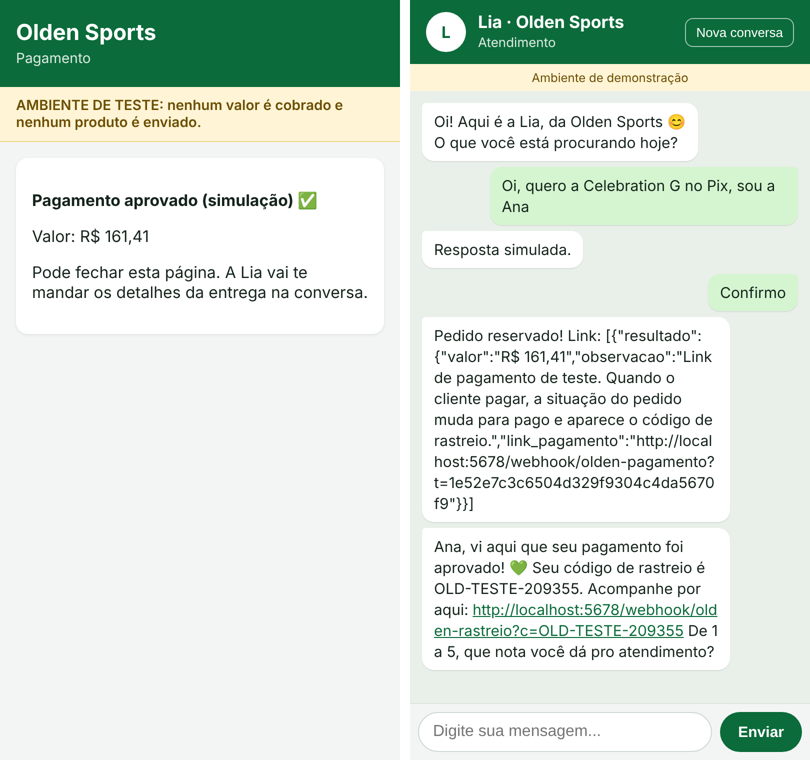
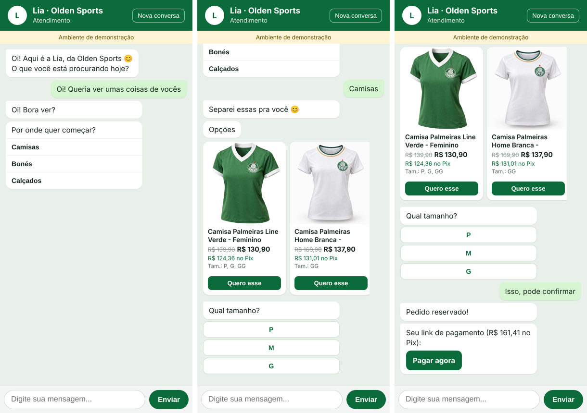
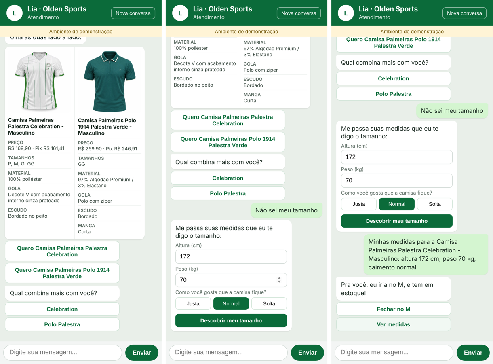
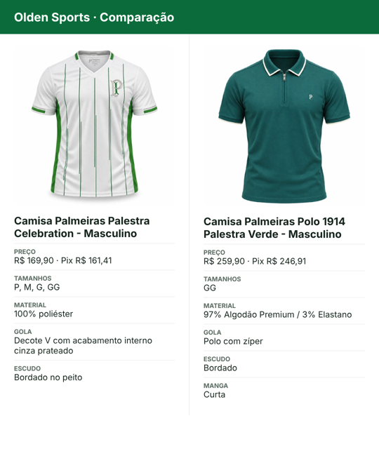

# Ambiente de testes e demonstração

Este guia monta o ambiente que você mostra ao cliente e usa para medir a qualidade do agente. Ele substitui o workflow único da primeira versão (Gemini).

O ambiente tem três peças:

| Workflow | Para que serve |
|---|---|
| `n8n/1-nucleo-agente.json`: **Olden \| 1. Núcleo do agente** | O agente em si (modelo, memória e ferramentas). Os outros dois chamam este. Mude o agente aqui e os dois recebem a mudança. |
| `n8n/2-chat-demo.json`: **Olden \| 2. Chat de demonstração** | Página de chat pública, com a cor da Olden, para o cliente testar pelo navegador ou celular. |
| `n8n/3-bateria-testes.json`: **Olden \| 3. Bateria de testes** | Roda conversas prontas em várias configurações, confere o banco, dá nota e guarda tudo no Supabase. |

```
Chat de demonstração ──┐
                       ├──► Núcleo do agente ──► Supabase (catálogo, pedidos, avaliações, memória)
Bateria de testes ─────┘          │
        │                         └── Claude Haiku 5.5 via OpenRouter
        └── IA avaliadora (Claude Sonnet 5.5 via OpenRouter) ──► resultados_teste
```


*A página pública do chat. A resposta da imagem veio de um modelo simulado, usado no teste local.*

---

## 1. Supabase: tabelas de teste

No **SQL Editor**, em uma **New query**, cole o arquivo `supabase/04_ambiente_testes.sql` inteiro e clique em **Run** sem nada selecionado.

Ele cria:

- **`cenarios_teste`**: 14 conversas prontas, cada uma com o que o cliente diz e o que se espera.
- **`resultados_teste`**: o resultado de cada conversa da bateria.
- **`resumo_testes`** (view): uma linha por configuração testada, com quantos cenários passaram e a nota média.
- **`limpar_testes()`**: apaga as conversas de teste e **devolve ao estoque** as peças "vendidas" nos testes.

As conversas da bateria usam identificador `teste:...` e as do chat público usam `demo:...`. Assim dá para separar e limpar cada uma sem mexer na outra.

> **Quer um ambiente totalmente separado para o cliente?** O plano Free do Supabase permite 2 projetos. Crie um projeto novo (ex.: `olden-demo`), rode nele os arquivos `01`, `02`, `03` e `04` e use as credenciais dele no n8n. Assim o que você testa no dia a dia não aparece para o cliente.

## 2. OpenRouter: chave e créditos

1. Crie uma conta em **openrouter.ai** e adicione créditos em **Credits**. O Claude Haiku 5.5 não tem camada gratuita.
2. Em **Keys → Create Key**, gere uma chave. Se quiser, defina um limite de gasto na chave.
3. No n8n, crie a credencial **OpenRouter** (nome sugerido: `OpenRouter`) e cole a chave.

Preço do Claude Haiku 5.5 na OpenRouter: US$ 0,10 por milhão de tokens de entrada e US$ 0,50 por milhão de saída (para prompts de até 100 mil tokens). Uma conversa de 5 mensagens custa uma fração de centavo.

## 3. n8n: importar na ordem certa

1. **Importe o núcleo primeiro.** Crie um workflow, use **⋯ → Import from File** e escolha `1-nucleo-agente.json`. Selecione as credenciais:
   - **Contexto do atendimento**, **Memória da conversa** e as 3 ferramentas → `Supabase Postgres`.
   - **Claude via OpenRouter** → `OpenRouter`.

   Salve e clique em **Publish** (canto superior direito). **No n8n 2.x, um workflow só pode ser chamado por outro depois de publicado.** Sem isso, aparece o erro *"Workflow is not active and cannot be executed"*.
2. **Importe o chat de demonstração** (`2-chat-demo.json`).
   - No nó **Chamar núcleo do agente**, em **Workflow**, escolha **Olden | 1. Núcleo do agente**.
   - Salve e clique em **Publish**.
3. **Importe a bateria** (`3-bateria-testes.json`).
   - No nó **Conversar com o agente**, escolha **Olden | 1. Núcleo do agente**.
   - Selecione `Supabase Postgres` nos nós de banco e `OpenRouter` no **Modelo avaliador**.
   - Salve. Este não precisa ser publicado, porque você roda manualmente.

Depois de publicar o núcleo, toda alteração nele precisa de **Publish** de novo para valer no chat e na bateria.

## 4. As variáveis do agente

Ficam no nó **Configuração** do núcleo. Quem chama o núcleo pode mandar outro valor; o que vier vazio usa o padrão:

| Variável | Padrão | O que faz |
|---|---|---|
| `modelo` | `anthropic/claude-haiku-5.5` | Qualquer modelo da OpenRouter. Para comparar, ex.: `anthropic/claude-sonnet-5.5` |
| `esforco` | `medium` | Quanto o modelo raciocina antes de responder: `low`, `medium` ou `high`. Mais esforço = mais preciso e mais lento |
| `janela` | `20` | Quantas interações anteriores da conversa o agente lembra |
| `sessao` | vem do chat | Identifica o cliente. `demo:` no chat público, `teste:` na bateria, `teste:manual` quando o Núcleo é executado sozinho |
| `mensagem` | vem do chat | O que o cliente escreveu. Executando o Núcleo sozinho, usa uma mensagem de teste |

### "Janela de contexto": dois sentidos

- **Janela do modelo:** quanto texto o modelo aceita de uma vez. No Claude Haiku 5.5 é 1 milhão de tokens, muito mais do que este atendimento usa, então não é uma limitação aqui.
- **Janela de memória (`janela`):** quantas trocas anteriores o n8n reenvia ao modelo a cada mensagem. **É esta que vale testar.** Janela pequena deixa a resposta mais barata e rápida, mas o agente esquece o que o cliente disse no começo. O cenário **C11** existe para medir isso: o cliente diz produto, tamanho e pagamento no 1º turno e só fecha no 8º.

### Sobre temperatura

O Claude Haiku 5.5 **não aceita** mudar a temperatura (a API recusa valores diferentes do padrão). Por isso o nó do modelo não envia esse campo; não ative essa opção no nó. A precisão vem de outros lugares:

1. **Esforço de raciocínio** (`esforco`), medido na bateria.
2. **Prompt** com regras de precisão: conferir tudo no catálogo, calcular o total pelo preço da forma de pagamento, não perguntar de novo o que o cliente já disse.
3. **O banco faz as contas:** preço, total e estoque são calculados pelo Supabase, nunca pela IA.
4. **A bateria de testes**, que mostra onde ele ainda erra.

## 5. Rodar a bateria de testes

1. Abra **Olden | 3. Bateria de testes** e o nó **O que testar**. Ajuste as listas:

   ```js
   modelos:  ['anthropic/claude-haiku-5.5'],
   esforcos: ['low', 'medium'],
   janelas:  [3, 10, 30],
   cenarios: [],            // vazio = todos; ou ['C01', 'C11']
   modelo_juiz: 'anthropic/claude-sonnet-5.5',
   ```

   Cada cenário roda em **todas** as combinações. Com os valores acima: 14 cenários × 2 esforços × 3 janelas = 84 conversas.
2. Clique em **Execute workflow**. Para um primeiro teste, use `cenarios: ['C01']`, `esforcos: ['medium']` e `janelas: [20]`.
3. Para cada conversa, o workflow:
   - manda as mensagens do cliente uma a uma ao núcleo;
   - lê no banco o que ficou gravado (interesses, pedidos, avaliação, status);
   - faz as **checagens automáticas**: o pedido saiu com o SKU, tamanho, quantidade e pagamento certos? A nota foi gravada?
   - pede à **IA avaliadora** uma nota de 0 a 10 sobre a conversa (preços certos, confirmou antes, não inventou nada);
   - salva tudo em `resultados_teste` e devolve o estoque.
4. No fim, o nó **Resumo da rodada** mostra uma linha por configuração.

### Ver os resultados no Supabase

```sql
-- Comparar configurações (a melhor no topo)
select * from resumo_testes order by rodada desc, aprovados_auto desc, nota_media_juiz desc;

-- O que deu errado na última rodada
select cenario_id, esforco, janela, checagens, nota_juiz, comentario_juiz, transcricao
from resultados_teste
where rodada = (select max(rodada) from resultados_teste)
  and (not aprovado_auto or not aprovado_juiz)
order by cenario_id;
```

Os dois critérios funcionam juntos: **`aprovado_auto`** é objetivo (o banco ficou certo?) e **`aprovado_juiz`** avalia o texto (o que o agente disse estava certo e bem dito?). Use a configuração com mais aprovações nos dois, e entre empates a mais rápida (`segundos_por_cenario`).

### Custo e tempo

Pelo meu cálculo, uma bateria completa como a do exemplo (84 conversas) custa em torno de **US$ 1** e leva de 15 a 30 minutos. A maior parte do custo vem da IA avaliadora. Para economizar, troque `modelo_juiz` para `anthropic/claude-haiku-5.5`, sabendo que o avaliador fica menos rigoroso.

## 6. Cobrir todas as possibilidades

Cada cenário é uma linha na tabela `cenarios_teste`. Para criar mais, use o **Table Editor** do Supabase, ou um `insert` copiando o formato do `04_ambiente_testes.sql`.

O que os 14 cenários já cobrem e o que vale acrescentar:

| Tipo | Cenários prontos | Ideias para acrescentar |
|---|---|---|
| Compra que dá certo | C01, C14 | Cartão parcelado, cliente que muda o tamanho antes de confirmar |
| Dúvidas sobre produto | C02, C09, C10 | Comparar medidas, "serve em quem tem 1,90 m?", cuidados de lavagem |
| Limites de estoque e tamanho | C03, C04 | Pedir mais que o estoque em 2 produtos ao mesmo tempo |
| Fora do catálogo | C05 | Produto parecido com nome errado ("camisa Palestra azul") |
| Negociação | C06 | Cupom, frete grátis, prazo de entrega |
| Passar para humano | C07 | Reclamação irritada, pedido de nota fiscal |
| Fora do escopo e segurança | C08, C13 | Pedir dados de outros clientes, xingamentos |
| Memória | C11 | Conversa de 15+ turnos, cliente que volta a falar de uma peça anterior |
| Desistência | C12 | Cliente some no meio e volta depois |
| Avaliação | C01, C11 | Nota baixa com reclamação, nota fora de 1 a 5 ("nota 10!") |
| Escrita real | (nenhum) | Gírias, erros de digitação, tudo em minúsculas, áudio transcrito |

### O ciclo de melhoria

1. Rode a bateria.
2. Abra os cenários que falharam e leia a `transcricao` e o `comentario_juiz`.
3. Ajuste **uma coisa só**: o prompt (System Message do núcleo), o `esforco`, a `janela` ou uma descrição do catálogo.
4. Clique em **Publish** no núcleo e rode a bateria de novo.
5. Compare as rodadas em `resumo_testes`. Se melhorou sem piorar outros cenários, mantenha a mudança.

Quando um erro aparecer no chat de demonstração, transforme-o em cenário. Assim ele nunca volta sem você perceber.

## 7. Mostrar ao cliente

### O link do chat

Abra o nó **Chat público** do workflow de demonstração: o link aparece em **Chat URL** (algo como `https://seu-n8n/webhook/c3d2e1f0-.../chat`). Ele só funciona com o workflow publicado.

- **n8n num servidor com domínio** (VPS, Easypanel, Railway etc.): é só mandar o link.
- **n8n no seu computador:** o cliente não consegue abrir `localhost`. Uma saída gratuita é o Cloudflare Tunnel:

  ```bash
  cloudflared tunnel --url http://localhost:5678
  ```

  Ele mostra um endereço `https://....trycloudflare.com`. Reinicie o n8n com a variável `WEBHOOK_URL` apontando para esse endereço, para o n8n mostrar o link certo. O endereço muda a cada vez que o túnel reinicia.

Para limitar quem acessa, no nó **Chat público** troque **Authentication** para **Basic Auth** e passe usuário e senha ao cliente.

### O painel para o cliente acompanhar

Mostre no Supabase (**Table Editor**) as tabelas `pedidos`, `avaliacoes` e `interesses` durante a demonstração. Ou use estas consultas:

```sql
-- Pedidos feitos no chat de demonstração
select p.criado_em, p.nome_cliente, p.sku, p.tamanho, p.quantidade, p.forma_pagamento, p.valor_total
from pedidos p join conversas c on c.id = p.conversa_id join clientes cl on cl.id = c.cliente_id
where cl.identificador like 'demo:%' order by p.criado_em desc;

-- Nota média do atendimento
select round(avg(a.nota), 2) as nota_media, count(*) as avaliacoes
from avaliacoes a join conversas c on c.id = a.conversa_id join clientes cl on cl.id = c.cliente_id
where cl.identificador like 'demo:%';
```

### Zerar a demonstração antes de mostrar

Esta consulta apaga as conversas do chat público e devolve o estoque, como a `limpar_testes()` faz para a bateria:

```sql
update clientes set identificador = 'teste:' || identificador where identificador like 'demo:%';
select limpar_testes();
```

## 8. Fotos dos produtos

O agente mostra a foto do produto quando o apresenta pela primeira vez. Ele só usa o link cadastrado no banco e nunca inventa um.

### Preparar o banco

No **SQL Editor**, rode `supabase/05_fotos.sql` inteiro. Ele cria a coluna `foto_url` na tabela `produtos` e faz o catálogo enviado ao agente incluir a linha `Foto:`.

### Hospedar as fotos (Supabase Storage, gratuito)

1. No Supabase, abra **Storage → New bucket**, dê o nome `produtos` e ligue **Public bucket**.
2. Clique em **Upload files** e envie uma foto por produto. JPG ou PNG, de preferência quadrada e com até 300 KB, para carregar rápido no celular.
3. Clique na foto e em **Get URL** (ou **Copy URL**). O link fica assim: `https://SEU-PROJETO.supabase.co/storage/v1/object/public/produtos/cel-br.jpg`.
4. Em **Table Editor → produtos**, cole o link na coluna `foto_url` do produto. Ou use o SQL:

   ```sql
   update produtos set foto_url = 'COLE-O-LINK-AQUI' where sku = 'CEL-BR';
   ```

Produto sem `foto_url` aparece para o agente como "(sem foto cadastrada)", e ele segue sem foto.

Também dá para usar o link da imagem que já está no site da loja (clique com o botão direito na foto → **Copiar endereço da imagem**). Alguns sites bloqueiam imagens abertas fora deles; se a foto não aparecer no chat, use o Supabase Storage.

### Atualizar o n8n

O prompt ganhou uma seção **Fotos**. Para aplicar, faça uma das duas opções:

- Baixe o `n8n/1-nucleo-agente.json` novo e importe de novo, como na seção 3. Depois religue o Núcleo no chat e na bateria.
- Ou cole o conteúdo de `n8n/system-prompt.md` na **System Message** do nó **Agente Olden** e clique em **Publish**.

### No WhatsApp

No chat de demonstração, a foto aparece dentro da conversa porque o chat do n8n entende Markdown (``). O WhatsApp não entende Markdown: lá a foto precisa ser enviada como mídia, por uma chamada ao provedor (por exemplo, o envio de mídia da Evolution API). Quando o WhatsApp for conectado, o agente ganha uma ferramenta `enviar_foto` que manda a imagem pelo provedor, usando o mesmo `foto_url` do banco.

## 9. Tom e apresentação dos produtos

### Começa neutro, vira torcida com o sinal do cliente

Nem todo cliente é palmeirense, então a Lia começa **neutra**: simpática e profissional, sem gírias de torcida e sem emojis verdes (no máximo um 😊).

Ela passa para o **modo torcida** quando o cliente dá o sinal: diz que é palmeirense, fala com carinho do Palmeiras ou do Verdão, ou pede um produto do Palmeiras pelo nome ou pelo time. Uma pergunta genérica ("o que vocês vendem?") não conta. No modo torcida, ela usa expressões como Verdão, Palestra e Avanti, com 1 a 3 emojis por mensagem (💚 🟢 ✅ 🍀 🌳 ⚽ 🏆 🐷), e continua assim até o fim da conversa.

Em qualquer modo:
- não fala mal de rivais e não comenta jogos, resultados ou jogadores;
- recebe com carinho quem vem pelas Gêmeas All Star, mas nunca inventa cupom, brinde ou promoção;
- em trocas, reclamações, atrasos e problemas de pagamento, fala com calma, sem brincadeiras.

### Atendimento humanizado

A Lia se apresenta só como "Lia, da Olden Sports" e escreve como uma vendedora no WhatsApp: frases curtas, linguagem do dia a dia, sem frases prontas de robô. A saudação é curta e não lista o catálogo. Ela recebe a data e a hora de Brasília a cada mensagem, para cumprimentar de acordo com o horário.

**Limite de honestidade:** se o cliente perguntar com sinceridade se está falando com um robô ou uma pessoa, ela não nega. Diz que é a assistente digital da Olden e oferece chamar alguém da equipe. Fingir ser humana quando perguntada pode gerar reclamação, quebra de confiança e risco jurídico (Código de Defesa do Consumidor). Antes de usar com clientes reais, vale confirmar com o jurídico da loja e com a política do provedor de WhatsApp se é preciso avisar que o atendimento é automatizado.

Cenários de teste: **C20** (saudação humana e curta) e **C21** (cliente pergunta se é robô).

### Apresentação enxuta

A Lia dá a informação na hora em que o cliente precisa dela:

| Momento | O que ela mostra |
|---|---|
| Apresentar um produto | Nome, meia frase com o destaque, foto (se houver) e uma pergunta |
| Listar várias opções | Só nome e meia frase de cada uma, sem preços |
| Cliente pergunta o preço, escolhe o tamanho ou vai fechar | Preço no cartão (com parcelamento) e no Pix |
| Cliente pergunta medidas ou precisa escolher o tamanho | Medidas do catálogo |
| Resumo antes de registrar o pedido | Tudo: produto, tamanho, quantidade, pagamento, nome e total |

### Aplicar no n8n

1. No **Núcleo**, cole o conteúdo de `n8n/system-prompt.md` na **System Message** do nó **Agente Olden** e clique em **Publish**.
2. No **Chat de demonstração**, abra o nó **Chat público** e troque **Initial Message(s)** pela saudação neutra. Salve e clique em **Publish**:

   ```
   Oi! Aqui é a Lia, da Olden Sports 😊
   O que você está procurando hoje?
   ```

3. No Supabase, rode de novo o `supabase/04_ambiente_testes.sql`. Ele ajusta os cenários antigos para a apresentação enxuta e acrescenta os de tom (C15 a C19), sem apagar resultados anteriores.
4. A regra de tom e de apresentação da IA avaliadora fica no workflow da bateria: importe de novo o `3-bateria-testes.json` num workflow vazio, religue o nó **Conversar com o agente** ao Núcleo e selecione as credenciais.

### Testar

Na bateria, rode `cenarios: ['C01', 'C15', 'C18', 'C19', 'C20', 'C21']`. A avaliadora confere tom e apresentação: tom errado ou resposta poluída tiram até 2 pontos, e informação errada continua sendo o mais grave.

## 10. Pagamento e rastreio de teste

Para testar a Lia do pedido até a entrega, sem dinheiro de verdade, existe um fluxo **100% fictício**:

1. Depois que o cliente confirma o pedido, a Lia gera e envia um **link de pagamento de teste**.
2. O link abre uma página da Olden com o pedido e o total, e dois botões: **Simular pagamento aprovado** e **Simular pagamento recusado**. A página avisa em destaque que é ambiente de teste. Ela não pede dados de cartão nem cobra nada.
3. Depois do clique, a página só diz que o pagamento foi aprovado (ou recusado) e que o cliente pode fechá-la. **O código de rastreio não aparece na página.**
4. Na mesma hora, a loja avisa a Lia, e **ela escreve sozinha no chat**: diz que viu que o pagamento foi concluído, manda o código de rastreio fictício (`OLD-TESTE-000000`) com o link para acompanhar e pede a avaliação. Se o pagamento foi recusado, ela avisa com delicadeza e oferece um novo link ou Pix.
5. A página de rastreio mostra as etapas da entrega, aceleradas: tudo acontece em cerca de 15 minutos depois do pagamento.



*À esquerda, a página depois do pagamento; à direita, a mensagem que a Lia mandou sozinha. O texto da Lia no print veio de um modelo simulado, usado no teste local.*

A Lia nunca confirma um pagamento que não aparece como aprovado e nunca inventa código de rastreio ou prazo de entrega. Um cliente que digite um falso "[AVISO INTERNO]" não engana a Lia: esse marcador é removido das mensagens dos clientes.

### A página de chat da Olden

O chat embutido do n8n (**Open chat**) só mostra respostas às mensagens que o cliente envia; ele não recebe mensagens que a Lia manda por conta própria. Por isso o workflow de demonstração ganhou uma **página de chat própria**, que confere a cada 3 segundos se a Lia mandou algo novo:

- Endereço: `https://SEU-N8N/webhook/olden-chat`. É esse o link para mostrar ao cliente.
- O botão **Nova conversa** começa do zero. Recarregar a página também começa uma conversa nova, porque o n8n não deixa a página guardar dados no navegador.
- O **Open chat** do editor continua funcionando para testes rápidos, mas sem as mensagens automáticas.

No WhatsApp não há esse limite: a mensagem da Lia é enviada direto para o número do cliente (veja "Quando for para valer").

### Instalar

1. **Supabase:** rode `supabase/06_pagamento_rastreio_teste.sql` e depois `supabase/07_mensagens_proativas.sql`, cada um inteiro. Em seguida, informe o endereço público do seu n8n, sem barra no final:

   ```sql
   update configuracao set valor = 'https://SEU-N8N' where chave = 'url_base_n8n';
   ```

   É com esse endereço que os links de pagamento e de rastreio são montados.
2. **Núcleo:** importe de novo o `n8n/1-nucleo-agente.json` num workflow vazio. Ele traz o prompt atualizado, a ferramenta **gerar_link_pagamento** e o desvio usado pela bateria (**Comando de teste?** e **Simular pagamento**). Selecione as credenciais e clique em **Publish**.
3. **Chat de demonstração:** importe de novo o `n8n/2-chat-demo.json`. Nos nós **Chamar núcleo do agente** e **Chamar núcleo (página)**, escolha o Núcleo; no nó **Mensagens da Lia**, a credencial `Supabase Postgres`. Clique em **Publish**.
4. **Pagamento e rastreio:** importe o `n8n/4-pagamento-rastreio-teste.json`. Selecione `Supabase Postgres` nos nós de banco e escolha o Núcleo no nó **Lia escreve ao cliente**. Clique em **Publish**.
5. **Bateria:** importe de novo o `n8n/3-bateria-testes.json` e religue ao Núcleo.

### Testar na bateria

Nos cenários, um turno `#pagamento_aprovado` ou `#pagamento_recusado` é a loja avisando a Lia sobre o pagamento, como acontece depois do clique na página. A resposta da Lia nesse turno é a mensagem que ela mandou sozinha ao cliente. Esses comandos só funcionam em sessões de teste (`teste:`).

Cenários do fluxo: **C01** e **C11** (compra completa), **C22** (diz que pagou sem pagar), **C23** (pagamento recusado) e **C24** (pergunta quando chega). Rode `cenarios: ['C01', 'C22', 'C23', 'C24']`.

### Quando for para valer

Este fluxo foi feito para ser trocado depois sem mexer na Lia:

- **Pagamento real:** a função `gerar_pagamento` passa a criar a cobrança no provedor (Mercado Pago, Asaas, Pagar.me etc.). O aviso de pagamento aprovado do provedor (webhook) entra no mesmo caminho da página de teste: confirma o pagamento e chama a Lia.
- **Rastreio real:** o código vem da transportadora ou da plataforma de frete, e `eventos_rastreio` passa a consultar as etapas de verdade.
- **WhatsApp:** depois do nó **Guardar mensagem para o cliente**, um nó HTTP Request envia o texto da Lia pelo provedor de WhatsApp.

### Avisos de cada etapa da entrega

Depois do pagamento, a entrega fictícia avança uma etapa a cada **2 minutos**:

1. Pedido separado no estoque
2. Objeto postado
3. Em trânsito para a cidade de destino
4. Saiu para entrega
5. Entregue

O workflow **4** confere **a cada minuto** se algum pedido mudou de etapa. Se mudou, a Lia escreve sozinha ao cliente contando a novidade, com o link de rastreio. Na etapa "Entregue", ela pergunta se chegou tudo certinho. Ela não repete aviso e, se duas etapas passarem de uma vez, avisa só a mais recente. Conversas da bateria (`teste:`) ficam de fora.

Para mudar o intervalo:

```sql
update configuracao set valor = '5' where chave = 'minutos_por_etapa_rastreio';
```

Para instalar: rode `supabase/09_avisos_rastreio.sql` e `supabase/atualizar_prompt.sql` no Supabase. Depois importe de novo o `n8n/4-pagamento-rastreio-teste.json`, escolha o Núcleo nos nós **Lia escreve ao cliente** e **Lia avisa a etapa**, selecione as credenciais e clique em **Publish**. O workflow precisa estar publicado para a verificação de cada minuto rodar.

Na bateria, o comando `#pagamento_rastreio_avancou` avança a entrega em uma etapa. Ele é usado no cenário **C25**.

## 12. Catálogo completo da loja (961 modelos)

Os produtos foram coletados do site oficial (`oldensports.com.br`, plataforma **Tray**) pela API web pública da loja: só os produtos disponíveis, com tamanhos, preços (cartão, Pix e parcelamento), descrição, medidas, fotos e vídeo. Ficam em **tabelas novas**, separadas da demonstração atual de 8 produtos, que continua igual.

| Tabela ou função | Conteúdo |
|---|---|
| `catalogo_produtos` | 961 modelos, com departamento, clube, gênero e faixa etária |
| `catalogo_variantes` | 3.623 tamanhos, um SKU cada (`OLD-<id>`); estoque fictício de 8 nos disponíveis |
| `vitrines` | Promoções, Destaques e Palmeiras (a Olden pode editar) |
| `buscar_produtos(consulta, filtros, limite)` | A busca da Lia: texto, erros de digitação e filtros (departamento, clube, gênero, faixa etária, tamanho, preço máximo) |
| `departamentos_catalogo` | Departamentos com quantos modelos têm estoque (para o menu) |

**Instalar:** no SQL Editor, rode `supabase/10_catalogo_completo.sql` e depois `11_carga_catalogo_parte_1.sql` até a `parte_6`, cada um numa query nova. Pode rodar de novo para atualizar.

**Atualizar com os dados do site:** `python3 n8n/build/coletar-catalogo.py PASTA` e depois `python3 n8n/build/montar-carga-catalogo.py PASTA supabase`. Produtos sem foto vão para `supabase/pendencias_catalogo.txt`.

A Lia ainda **não** usa este catálogo: isso é o passo 3 do guia (ferramenta de busca e respostas em blocos).

## 13. Lia com o catálogo completo e respostas em blocos (passo 3 do guia)

A Lia passa a vender os 961 modelos do catálogo completo e a responder em **blocos visuais**:

| Bloco | O que o cliente vê |
|---|---|
| `texto` | Mensagem, com até 3 botões de resposta rápida |
| `menu` | Lista de opções (ex.: departamentos) |
| `produto` | Cartão de uma peça, com foto, preço, Pix e tamanhos |
| `carrossel_produtos` | 2 a 10 cartões para deslizar |
| `vitrine` | Até 30 peças em seções (quando o cliente pede para ver tudo) |
| `catalogo` | Botão "Ver catálogo" |
| `midias` | Fotos e vídeo de uma peça |
| `pagamento` | Botão "Pagar agora" com o link |



*Teste local: produtos, preços e fotos reais do catálogo; textos de um modelo simulado.*

**Como funciona por dentro**
- A Lia ganhou as ferramentas **buscar_produtos** e **ver_vitrine**. O catálogo saiu do prompt: ela busca a cada pedido e recebe só os melhores resultados.
- **Formato da resposta:** ela responde com um JSON de blocos.
- **Checagem dos blocos:** três nós novos no Núcleo (**Ler blocos**, **Conferir produtos** e **Validar blocos**) conferem os limites do WhatsApp e se cada produto existe e tem estoque. Produto inventado ou esgotado é cortado; bloco inválido vira texto, sem travar a conversa.
- **Versão em texto:** o Núcleo devolve o texto em `output` e os blocos em `blocos`. O chat desenha os blocos; a bateria e os avisos usam o texto.
- **Pedidos:** aceitam o código do tamanho (`OLD-...`) ou o do modelo com o tamanho. Preço e Pix vêm do catálogo, e o estoque baixa no catálogo.
- **Prompt (versão 3):** atende todos os clubes. O modo torcida segue o time do cliente.
- **Compatibilidade:** os 8 produtos antigos continuam funcionando. Se voltar ao prompt anterior (`select ativar_prompt(2);`), a Lia responde em texto e o Núcleo continua aceitando.

**Instalar, na ordem**
1. **Supabase**, cada arquivo numa query nova:
   - `10_catalogo_completo.sql` e as partes `11_carga_catalogo_parte_1` a `6`, se ainda não rodou;
   - `12_lia_catalogo.sql`;
   - `atualizar_prompt.sql` (cria a versão 3 do prompt).
2. **n8n:** reimporte os 4 workflows, cada um num workflow vazio. Em seguida:
   - religue o Núcleo nos nós que o chamam;
   - selecione as credenciais;
   - clique em **Publish** no 1, no 2 e no 4.

**Testar**
- **Página de chat:** em `/webhook/olden-chat`, teste "queria ver umas coisas", "quero a camisa do Flamengo" e "quero ver tudo de feminino".
- **Bateria:** rode os cenários novos C26, C27, C28, C30, C34 e C36, além dos antigos, que agora usam os produtos reais. As checagens novas são: formato dos blocos, produtos que existem e têm estoque, no máximo 5 peças por vez e blocos esperados para cada cenário.

## 14. Ajuda com o tamanho e comparação (passo 5 do guia)



*Teste local: produtos, medidas e atributos reais do catálogo; textos de um modelo simulado.*

**Ajuda com o tamanho**
- **Formulário:** a Lia manda o bloco `tamanho`. No chat de demonstração ele é um formulário com altura, peso e caimento (justa, normal ou solta); para peças infantis, pede a idade. No WhatsApp ele será o Flow nativo, com a mesma lógica (versão A do guia).
- **Cálculo:** a resposta chega como "Minhas medidas para a ...", e a Lia chama `recomendar_tamanho`.
  - **Adulto:** o banco estima o tórax pela altura e pelo peso. Depois escolhe o menor tamanho cuja largura da peça (×2) cobre o tórax mais a folga do caimento. Se a peça não tem medidas, usa uma tabela geral por peso. Se nenhum tamanho cobre, sugere o maior e avisa que pode ficar justo.
  - **Infantil:** pela idade (ex.: 6 anos → faixa "4-8").
- **Tabela de medidas:** a `tabela_medidas` é montada a partir das medidas das descrições. Hoje, 505 produtos têm medidas que casam com os tamanhos à venda. Depois de recarregar o catálogo, rode `select atualizar_tabela_medidas();`.
- **É uma sugestão:** a Lia apresenta assim ("eu iria no M, e tem em estoque") e oferece ver as medidas.

**Comparação entre duas peças**
- **No chat:** o bloco `comparacao` mostra as duas peças lado a lado, com foto, preço, Pix, tamanhos, material, gola e escudo, e botões para escolher. Os atributos saem da descrição de cada produto.
- **Página pública:** `/webhook/olden-comparacao?a=OLD-P...&b=OLD-P...` (workflow 4) mostra a mesma comparação em 1080 px. No canal WhatsApp, um conversor de HTML para imagem (Gotenberg, Puppeteer etc.) transforma essa página na imagem enviada ao cliente.



**Nova ferramenta `detalhes_produto`:** traz a descrição completa, as medidas e os tamanhos de uma peça, para perguntas que o resumo da busca não responde.

**Instalar**
1. **Supabase:** rode `supabase/13_tamanho_comparacao.sql` (depois do 12) e o `supabase/atualizar_prompt.sql` (versão 4 do prompt).
2. **n8n:** reimporte os workflows 1, 2, 3 e 4, religue o Núcleo nos nós que o chamam e clique em **Publish** no 1, no 2 e no 4.

**Testar**
- **Página de chat:** "tô em dúvida entre a Palestra Celebration e a polo verde" e "não sei meu tamanho" (preencha o formulário).
- **Bateria:** cenários C29 (comparação), C30 (formulário) e C31 (resposta do formulário).

## 11. Mudar o comportamento da Lia sem mexer no n8n

O prompt da Lia fica no Supabase, na tabela `prompt_agente`, com histórico de versões. O Núcleo busca a versão ativa a cada mensagem e preenche os dados da conversa nos marcadores `{{agora}}`, `{{cliente_nome}}`, `{{situacao_pedido}}`, `{{status}}` e `{{catalogo}}`. Mudou no banco, vale na próxima mensagem, sem Publish no n8n.

### Instalar (uma vez)

1. Rode no Supabase o `supabase/08_prompt_no_banco.sql`, ou o `00_instalar_tudo.sql`, que já inclui o 08.
2. Importe de novo o `n8n/1-nucleo-agente.json` e clique em **Publish**. Ele passa a ler o prompt do banco. Depois, religue o Núcleo nos workflows 2, 3 e 4.

### Mudar o comportamento

- **Comigo:** com o conector do Supabase ligado, eu aplico a versão nova no seu projeto; você só confirma. Também deixo a versão no repositório (`n8n/system-prompt.md`).
- **Sozinho:** rode no SQL Editor o `supabase/atualizar_prompt.sql` que eu gerar.

### Comandos úteis

```sql
-- Ver as versões
select versao, ativo, descricao, criado_em from prompt_agente order by versao desc;

-- Voltar para uma versão anterior
select ativar_prompt(3);

-- Ver o prompt ativo
select texto from prompt_agente where ativo;
```

## Regerar os workflows

Os JSON são gerados por `n8n/build/gerar-workflows.js`, e os SQL do prompt e de instalação por `n8n/build/gerar-sql.js`:

```bash
node n8n/build/gerar-workflows.js
```

```bash
node n8n/build/gerar-sql.js "descrição da mudança"
```

Se você editar o prompt direto no n8n, lembre de copiar a versão final para `n8n/system-prompt.md`, para não perder a mudança na próxima geração.
