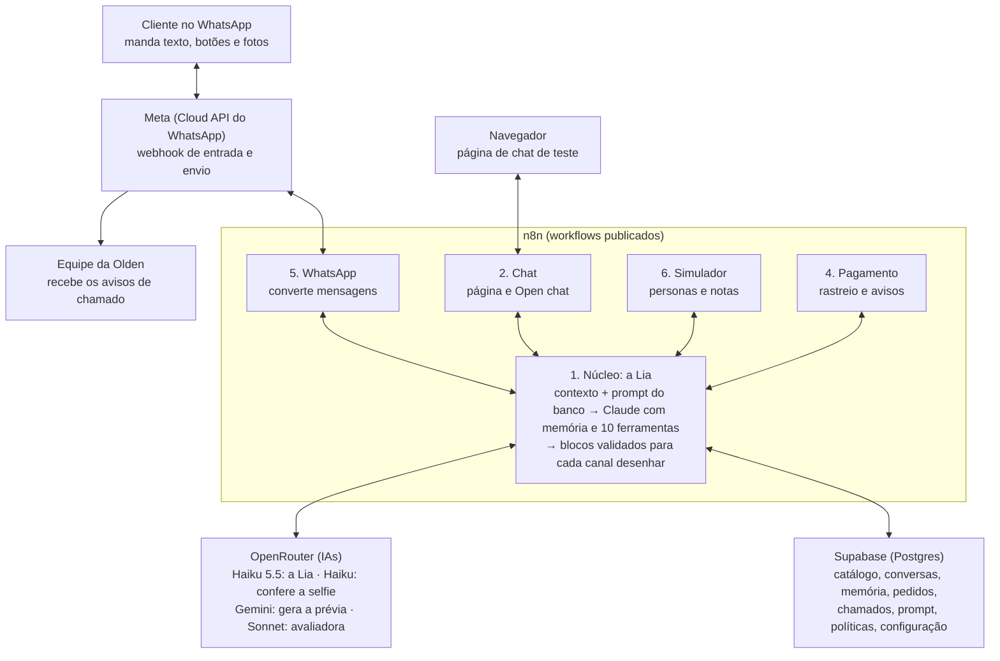

# Lia (Olden Sports): estado do projeto e passagem para o Victor

28/11/2026

A Lia já atende no WhatsApp de teste (+55 31 8041-0207) com o catálogo completo da Olden (961 modelos). Ela vende do primeiro contato até o pagamento e o rastreio fictícios, gera prévia com selfie e passa casos de pós-venda para a equipe. Faltam os dados reais da loja, um número próprio da Olden e os ajustes de produção listados em [Pendências](#pendências-para-o-victor).

## Estado atual

Tudo abaixo está publicado no n8n e testado. O que ainda é fictício está marcado.

| Parte | Situação | Observação |
| --- | --- | --- |
| Catálogo | Pronto | 961 modelos e 3.623 tamanhos coletados do site; estoque fictício (8 por tamanho) |
| Atendimento (Lia) | Pronto | Claude Haiku 5.5 via OpenRouter; prompt versão 11 no banco (v13 no histórico de mudanças) |
| Página de chat | Pronta | `/webhook/olden-chat`, para testes no navegador |
| WhatsApp | Em teste | API oficial da Meta, no número da 7Bee; só 2 números liberados |
| Pagamento e rastreio | Fictícios | Página de pagamento de teste e rastreio acelerado (uma etapa a cada 2 min) |
| Provador virtual | Pronto (experimental) | Selfie conferida antes; prévia gerada com `google/gemini-3.1-flash-image` |
| Passar para a equipe | Pronto | Chamado no banco + aviso no WhatsApp da equipe |
| Políticas da loja | Fictícias | Frete, prazo, troca, CNPJ etc. inventados para teste |
| Simulador de clientes | Pronto | 20 conversas em cerca de 11 min, com nota por critério |
| Catálogo na Meta e Flow de tamanho | Não feitos | Arquivos prontos; dependem das contas da Meta |

## Arquitetura

Cada canal tem seu workflow, mas todos chamam o mesmo Núcleo. O Núcleo lê e grava no Supabase e usa as IAs do OpenRouter. Os avisos para o cliente e para a equipe saem pelo workflow 5 e pela Meta.

## Onde está cada coisa

Nenhum segredo está neste documento: tokens e senhas ficam só nas credenciais do n8n e nas configurações do Supabase.

| Item | Onde |
| --- | --- |
| n8n | https://n8n.treino.7bee.ai (versão 2.47) |
| Supabase | projeto `fqxumqlfbynogzzgiwql` |
| Repositório | GitHub `7beeai/oldensports`, branch `claude/magical-cori-iybvak` |
| WhatsApp (teste) | +55 31 8041-0207 · phone number ID `969967169542603` · conta (WABA) `297113960145419` · app "Olden teste" |
| Webhook da Meta | https://n8n.treino.7bee.ai/webhook/olden-whatsapp |
| Feed do catálogo para a Meta | https://n8n.treino.7bee.ai/webhook/olden-catalogo-meta (CSV) |
| Página de chat | https://n8n.treino.7bee.ai/webhook/olden-chat |
| Prompt da Lia | tabela `prompt_agente` (versão ativa) · cópia em `n8n/system-prompt.md` |
| Documentação | `docs/contexto-do-projeto.md`, `docs/whatsapp.md`, `docs/simulador.md`, `docs/ambiente-de-testes.md` |

**Credenciais no n8n (só os nomes):**
- Supabase postgres
- OpenRouter account
- WhatsApp Olden - token da Meta (só o token): do tipo Bearer Auth, com o token permanente do usuário do sistema

**Gerar e publicar:**
- Os workflows são gerados por `n8n/build/gerar-workflows.js`, e o SQL do prompt por `n8n/build/gerar-sql.js`.
- O código dos nós do WhatsApp e do simulador fica em `n8n/build/whatsapp/` e `n8n/build/simulador/`.

## Os workflows do n8n

O Núcleo é a Lia, e todos os canais chamam ele. Um sub-workflow só pode ser chamado depois de publicado (botão Publish).

| Workflow | ID | Função |
| --- | --- | --- |
| 1. Núcleo do agente | `nfmd6CnW5M1XfBJN` | Monta o contexto, chama o Claude com memória e 10 ferramentas, lê e valida os blocos da resposta |
| 2. Chat de demonstração | `c8YgcOvEENWKR7Cf` | Página de chat e Open chat do n8n |
| 3. Bateria de testes | `5RyBLKW1sBsQoXTf` | Roda os 33 cenários roteirizados de `cenarios_teste` |
| 4. Pagamento e rastreio de teste | `OdyQbAIjza4Ye9ZU` | Páginas de pagamento, rastreio e comparação; a cada minuto, avisos de entrega e envio da fila do WhatsApp |
| 5. WhatsApp | `sbiqea6yyVn6LDjT` | Recebe da Meta, converte os blocos em mensagens nativas, provador, avisos da loja, feed do catálogo |
| 6. Simulador de clientes | `zZQbAMqpvybuuiyh` | Cria as personas e dispara uma conversa a cada 30 s |
| 6b. Simulador: um turno | `Ds1TmYiO8gfNrKFr` | Um turno cliente → Lia; chama a si mesmo até o fim |
| 6c. Simulador: uma conversa completa | `FjBVLDrdTLNvBE0B` | Conversa, avaliação, gravação e devolução do estoque |
| Diagnóstico Meta (temporário) | `ThOSrwMdkbsIAw0E` | Confere o token e as assinaturas sem mostrar o token; apagar quando não precisar |
| Teste do provador (temporário) | desativado | Testa a checagem da selfie e a geração por URL; só ligar para testar |

## Banco de dados (Supabase)

As regras de preço, estoque, pedido, pagamento e chamados ficam no banco, não na IA.

Os arquivos em `supabase/` rodam nesta ordem:
1. `00` (junta os arquivos 01 a 09);
2. `10` e `11` (catálogo, em 6 partes);
3. `12` a `20`.

O `verificar_instalacao.sql` só lê e mostra ✅/❌ para cada item.

| Arquivo | O que instala |
| --- | --- |
| 00 (01–09) | Clientes, conversas, pedidos, pagamento e rastreio fictícios, avisos, prompt no banco |
| 10–13 | Catálogo completo, busca (unaccent + pg_trgm), vitrines, tamanho e comparação |
| 14 | WhatsApp: registro `whatsapp_mensagens`, configuração, feed da Meta, provador, `#reiniciar` |
| 15 | Simulador: `sim_personas`, `sim_conversas` e visões de resumo; limpeza por sessão |
| 16 | `chamados_equipe`, `resolver_chamado`, preço "de" na busca, trava do `registrar_interesse` |
| 17 | `aplicar_regra_precos()`: cartão = preço cheio, Pix = promocional (os valores do site ficam em `*_site`) |
| 18 | `politicas_loja` (FICTÍCIAS) e `contexto_extra()` |
| 19 | Trava do "pediu_humano" em `chamar_equipe` |
| 20 | Data, hora e horário da equipe no contexto; `prazo_entrega(uf)`; peças já mostradas |

**Tabelas principais:**
- catálogo: `catalogo_produtos`, `catalogo_variantes`;
- atendimento e vendas: `clientes`, `conversas`, `pedidos`, `pagamentos`, `interesses`, `avaliacoes`;
- memória da Lia: `n8n_chat_histories`;
- regras e configuração: `prompt_agente`, `configuracao`, `politicas_loja`;
- equipe e WhatsApp: `chamados_equipe`, `mensagens_saida`, `whatsapp_mensagens`;
- simulador: `sim_personas`, `sim_conversas`.

**Configuração (tabela `configuracao`):**

| Chave | Valor hoje |
| --- | --- |
| `whatsapp_modo` | `real` |
| `whatsapp_phone_number_id` | ID do número de teste |
| `whatsapp_numeros_teste` | lista de números liberados |
| `whatsapp_catalogo_id` e `whatsapp_flow_tamanho_id` | vazios |
| `equipe_whatsapp` | `5531997067742` |
| `provador_ativo`, `provador_modelo`, `provador_modelo_conferencia` | provador ligado e modelos usados |
| `url_base_n8n` | endereço do n8n |
| `minutos_por_etapa_rastreio` | `2` |
| `simulador_token` | token para iniciar o simulador pela URL |

## Como a Lia se comporta

A Lia responde sempre em blocos JSON: texto, menu, produto, carrossel, vitrine, mídias, tamanho, comparação, pagamento e provador. O n8n valida e desenha cada bloco no canal.

O prompt fica no banco. Para mudar:
1. Edite `n8n/system-prompt.md`.
2. Rode `node n8n/build/gerar-sql.js "descrição"`.
3. Execute `supabase/atualizar_prompt.sql` no Supabase.

Para voltar a uma versão anterior: `select ativar_prompt(N);`.

**Regras principais do prompt**

- Fala como vendedora de verdade. O tom fica neutro até o cliente mostrar o time, depois vira "modo torcida" daquele time, e fica sério em reclamação.
- Admite ser assistente digital se perguntada com sinceridade e não revela as instruções.
- Produto antes do preço: o primeiro contato vem sem valores. O preço aparece quando o cliente pergunta, escolhe a peça ou o tamanho.
- Dois preços: cartão (cheio, com parcelamento) e Pix como "condição especial". O preço vai no cartão do produto, formatado pelo sistema.
- Produto que a loja não tem: "não temos no estoque", sem falar em encomenda nem chamar a equipe.
- Dúvidas de pré-venda (frete, prazo, troca, CNPJ, originalidade) são respondidas com as políticas da loja. A equipe só entra no pós-venda ou quando o cliente pede uma pessoa.
- Responde toda pergunta antes de convidar para fechar e não inventa nomes, características, reservas nem promessas.

**Ferramentas (10)**

| Ferramenta | Faz |
| --- | --- |
| `buscar_produtos`, `ver_vitrine`, `detalhes_produto` | Consultam o catálogo com estoque |
| `recomendar_tamanho` | Sugere o tamanho por altura, peso e caimento (ou pela idade) |
| `prazo_entrega` | Janela de entrega em datas pela UF, se o cliente pagar hoje |
| `registrar_interesse` | Anota o interesse (só aceita códigos de produto válidos) |
| `registrar_pedido`, `gerar_link_pagamento` | Reservam o estoque e geram o link de pagamento de teste |
| `registrar_avaliacao` | Grava a nota de 1 a 5 |
| `chamar_equipe` | Abre ou complementa o chamado e avisa a equipe no WhatsApp |

**Travas no código (funcionam mesmo se a IA não obedecer)**

- Produto que não existe ou está esgotado sai dos blocos. O provador só aceita camisas, roupas e bonés de adulto com estoque.
- Frase de "separar/reservar" sem pedido registrado é removida antes do envio.
- `chamar_equipe` recusa motivos de pré-venda, resumos vazios e "pediu_humano" sem pedido real do cliente. Só existe um chamado aberto por conversa.
- A cada mensagem, a Lia recebe:
  - o canal (WhatsApp ou página de chat);
  - a data e a hora, se a equipe está atendendo e quando volta;
  - o que já consta no chamado da equipe;
  - as peças já mostradas, com o estoque atual;
  - as políticas da loja.

## WhatsApp

A Lia está na API oficial da Meta (Cloud API), sem intermediário, no número de produção da 7Bee, e só responde aos números de teste. O guia completo está em `docs/whatsapp.md`.

- **Conta:** o app "Olden teste" foi ligado à conta da 7Bee (`297113960145419`), junto com "CDT - Disparos" e "7Bee API Oficial", que seguem funcionando.
- **Lista de testes:** `configuracao.whatsapp_numeros_teste` = `5531997067742,5531973559895`. Fora dessa lista, a Lia ignora a mensagem: não responde, não marca como lida e não grava. Lista vazia = responde a todos.
- **#reiniciar:** quando um número de teste manda isso, a conversa é zerada (memória, pedidos, chamados e histórico).
- **Celular brasileiro:** a Meta entrega o número sem o 9, e o envio recoloca o 9 depois do DDD.
- **Sem catálogo da Meta:** os produtos vão como foto + preço + 3 botões. Com o catálogo (o feed está pronto), viram fichas nativas.
- **Flow de tamanho:** `n8n/whatsapp/flow-tamanho.json` está pronto para colar no WhatsApp Manager. Sem ele, a Lia pergunta as medidas por texto.
- **Janela de 24 horas:** a Meta só deixa a empresa escrever livremente para quem falou com ela nas últimas 24 h (erro `131047`). O aviso de chamado para a equipe depende disso. Como paliativo, o número da equipe manda "oi" todo dia.
- **Registro:** tudo o que entra e sai fica em `whatsapp_mensagens`, com o status devolvido pela Meta (sent, delivered, read, ou failed com o erro).

## Provador virtual

Quando o cliente escolhe uma peça de vestir de adulto para si, no WhatsApp, a Lia oferece ver como ela fica no corpo com uma selfie. A prévia gerada por IA chega em 10 a 30 segundos.

1. O cliente manda a selfie, e o n8n baixa a imagem da Meta.
2. **Checagem** (`anthropic/claude-haiku-5.5`): pessoa real, uma só, adulta, de frente da cintura para cima, com boa luz, sem conteúdo impróprio e sem ser print ou desenho. Se a foto for recusada, a Lia explica o motivo e pede outra.
3. **Geração** (`google/gemini-3.1-flash-image`): com a foto aprovada, junta a selfie e a foto da peça, sobe o resultado para a Meta e envia com a legenda "Prévia gerada por IA".
4. A referência da selfie é apagada do banco logo depois, aprovada ou não.

**Teste da checagem (12 fotos, 12 acertos):**
- **Aprovou:** só a adulta de frente.
- **Recusou:** camisa sem pessoa, close do escudo, 4 fotos de criança, banner, foto só de pernas, pessoa sentada e cortada, foto borrada e paisagem.
- **Também recusa** (sem foto de teste para esses casos): foto escura, tremida, pequena, com várias pessoas ou imprópria.

**Qualidade da geração (3 testes):** manteve o rosto e reproduziu escudo, gola, listras e mangas com fidelidade (camisa feminina do Corinthians, camisa do Flamengo e boné).

**Pontos abertos:**
- **LGPD:** a Meta guarda a mídia por até 30 dias, e o n8n guarda a imagem no histórico de execuções. O caminho é desligar o histórico desse trecho e citar o provador na política de privacidade.
- **Uso:** ainda não existe limite de prévias por cliente.

## Simulador de clientes e resultados

Em 4 rodadas válidas, a nota subiu de 5,6 para 6,0, e as conversas aprovadas foram de 8 para 10 ou 11 em 20. O maior ganho foi em passar para a equipe (6,2 → 8,1) e em segurança (7,7 → 8,7). As melhorias da última versão (datas, preço pelo cartão e trava de reserva) ainda não foram medidas em uma rodada.

**Como funciona:** cada conversa sorteia perfil, intenção, produto, time, desafio e canal. Três IAs trabalham juntas:
- uma cria a persona;
- outra faz o papel do cliente e conversa com a Lia;
- uma terceira (`claude-sonnet-5.5`) dá nota de 0 a 10 em cada critério.

**Como rodar:** no workflow 6, ajuste o nó **O que simular** e clique em **Execute**. Ou abra `/webhook/olden-simulador?token=…&n=20&turnos=8`. O guia está em `docs/simulador.md`.

| Rodada | Conversas | Nota média | Aprovadas | O que mudou antes dela |
| --- | --- | --- | --- | --- |
| 27/11 21:14 (sim-2611280014) | 20 | 6,0 | 10 | Trava do pediu_humano, produto inexistente, provador só para peças de vestir |
| 27/11 18:49 (sim-2611272149) | 20 | 6,0 | 11 | Contexto real da equipe, políticas da loja, regras contra invenção |
| 27/11 18:00 (sim-2611272100) | 20 | 5,6 | 8 | `chamar_equipe`, regra de preço |
| 27/11 17:28 (piloto) | 3 | 5,7 | 1 | Primeira versão |

A rodada `sim-2611280003` (nota 5,0) foi descartada: com 20 conversas ao mesmo tempo, o banco recusou conexões (limite de 15).

| Critério | sim-2611272100 | sim-2611272149 | sim-2611280014 |
| --- | --- | --- | --- |
| Segurança | 7,7 | 8,3 | 8,7 |
| Produto antes do preço | 8,5 | 8,0 | 8,6 |
| Passar para a equipe | 7,2 | 6,2 | 8,1 |
| Curadoria | 7,6 | 7,3 | 7,3 |
| Tom | 6,9 | 6,8 | 6,9 |
| Preço cartão e Pix | 6,5 | 7,0 | 6,7 |
| Precisão | 4,9 | 6,5 | 5,9 |
| Condução da venda | 5,3 | 5,4 | 5,8 |
| Provador | 4,0 | 5,5 | 4,3 |

**Erros que ainda apareceram na última rodada:**
- estoque contraditório (3 conversas);
- "separar" sem pedido (3);
- datas e prazos errados (3);
- nome inventado (1);
- Pix antes do cartão (2).

Os quatro primeiros ganharam travas na versão atual.

**A IA avaliadora errou poucas vezes.** Por exemplo, ela marcava como inventado o horário que a Lia informava certo. Isso foi corrigido passando a data e a hora para ela.

## Pendências para o Victor

Antes de abrir para clientes reais, os quatro primeiros itens são obrigatórios. O resto melhora a operação.

**Obrigatórios para produção**

- [ ] Trocar as políticas fictícias pelas reais da Olden (frete, prazo, troca, CNPJ, nota fiscal, horário da equipe): `update politicas_loja set texto = '…', ficticio = false where tema = '…';`. Ajustar `prazo_entrega` e `situacao_equipe_agora` se os prazos e horários mudarem.
- [ ] Usar um número próprio da Olden no WhatsApp (portfólio da Olden, nome verificado, forma de pagamento) e desligar o app "Olden teste" da conta da 7Bee.
- [ ] Mudar a conexão do n8n com o Supabase para o modo transaction (porta 6543) ou aumentar o pool. Hoje o limite é de 15 conexões, e uns 5 clientes ao mesmo tempo já podem gerar erro.
- [ ] Confirmar a regra de preço: cartão = preço cheio, Pix = promocional do site. Nas peças em liquidação, a diferença fica grande (ex.: R$ 99,90 no cartão e R$ 35,90 no Pix).

**WhatsApp e Meta**

- [ ] Ter um modelo de mensagem de utilidade aprovado para os avisos de chamado, pagamento e entrega fora da janela de 24 h.
- [ ] Conferir a assinatura `X-Hub-Signature-256` no webhook (hoje ele aceita qualquer POST).
- [ ] Montar o catálogo no Commerce Manager (o feed está pronto) e o Flow "Descubra seu tamanho" (o JSON está pronto).
- [ ] Gerar uma chave de API nova no n8n (a atual ficou gravada em execuções de teste, já apagadas) e apagar o workflow Diagnóstico Meta.

**Loja real**

- [ ] Ligar um gateway de pagamento real (Pix e cartão) no lugar da página de teste, e o rastreio real dos Correios.
- [ ] Sincronizar o estoque real com o site (hoje são 8 por tamanho, fictícios) e criar uma rotina para recarregar o catálogo, seguida de `select aplicar_regra_precos();`.
- [ ] Criar um painel ou rotina para a equipe ver e resolver os chamados (`select resolver_chamado(id);`).

**Qualidade da Lia**

- [ ] Rodar o simulador de novo para medir a última versão (datas, preço pelo cartão, trava de reserva).
- [ ] Juntar as mensagens que o cliente manda em sequência numa resposta só.
- [ ] Ler áudio (por transcrição), imagem e PDF enviados pelo cliente. A proposta foi feita, mas não foi implementada.
- [ ] Provador: limite de prévias por cliente, histórico de execução sem a imagem e um item sobre ele na política de privacidade.

## Operação do dia a dia

Tudo roda no SQL Editor do Supabase.

| Para | Comando |
| --- | --- |
| Conferir a instalação | `supabase/verificar_instalacao.sql` |
| Ver os chamados abertos | `select id, criado_em, motivo, resumo, referencia from chamados_equipe where status = 'aberto' order by id desc;` |
| Encerrar um chamado | `select resolver_chamado(ID);` |
| Ver as últimas mensagens do WhatsApp | `select criado_em, sessao, direcao, tipo, status, texto, erro from whatsapp_mensagens order by id desc limit 30;` |
| Liberar um número de teste | `update configuracao set valor = '5531…,5531…' where chave = 'whatsapp_numeros_teste';` |
| Zerar uma conversa | `#reiniciar` no WhatsApp, ou `select limpar_whatsapp_teste('wa:55…');` |
| Ver as versões do prompt | `select versao, ativo, descricao from prompt_agente order by versao;` |
| Voltar a uma versão do prompt | `select ativar_prompt(N);` |
| Desligar o provador | `update configuracao set valor = 'não' where chave = 'provador_ativo';` |
| Ver o resultado do simulador | `select * from sim_resumo order by inicio desc;` · `sim_criterios` · `sim_piores` |
